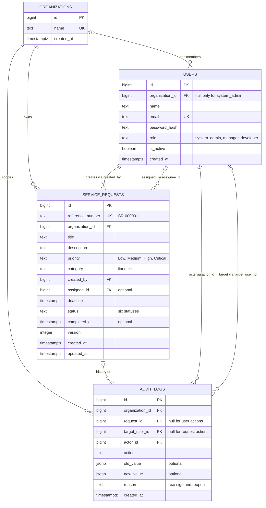

# Database Design

**Project:** Multi-Tenant Service Request & Approval Management System
**Database:** PostgreSQL (PDF §3 allows PostgreSQL or MySQL)
**Inputs:** Assessment PDF, `docs/permissions.md`, `docs/transitions.md`, decisions D1–D18

> This is a **design document**. The few SQL lines in Section 6 only illustrate an idea. The real SQL goes into migrations.

---

## 1. Labels

| Label | Meaning |
|---|---|
| **[PDF]** | Required or stated by the assessment PDF |
| **[DECISION D#]** | A decision the candidate confirmed because the PDF is silent |
| **[PROPOSED]** | A design choice that fills a technical gap. Listed in the report as an assumption |

---

## 2. The design in simple English

- **Four tables:** `organizations`, `users`, `service_requests`, `audit_logs`.
- An **organization** is a client company. Every user belongs to one, except the **System Admin**, who belongs to none.
- A **service request** belongs to exactly one organization, records its creator, and may have an assignee.
- An **audit log** row is a permanent diary entry: who did what, when, and what changed.
- **Isolation is built into the database.** Special "composite" foreign keys make PostgreSQL refuse links between rows of different organizations, for example assigning a developer from another organization.
- **Overdue is not stored.** It is calculated from the deadline and the status.
- **Nothing is deleted.** Users are deactivated, so history always stays valid.

---

## 3. ER diagram



> The composite foreign keys that also compare `organization_id` are not drawn. They are listed in Section 5.

---

## 4. Table details

"Required" means `NOT NULL`.

### 4.1 `organizations`

| Column | Type | Required | Notes | Label |
|---|---|:---:|---|---|
| `id` | bigint identity | ✅ | Primary key | [PROPOSED] |
| `name` | text | ✅ | Unique, not blank | [PROPOSED] |
| `created_at` | timestamptz | ✅ | Default now | [PROPOSED] |

Organization metadata = name, created date and member counts (A2). There is no `is_active` column because the PDF does not mention deactivating organizations.

### 4.2 `users`

| Column | Type | Required | Notes | Label |
|---|---|:---:|---|---|
| `id` | bigint identity | ✅ | Primary key | [PROPOSED] |
| `organization_id` | bigint | Conditional | FK to `organizations`. **Required for managers and developers, empty for the System Admin** | [PDF] §4 |
| `name` | text | ✅ | | [PROPOSED] |
| `email` | text | ✅ | Login name. Unique, case-insensitive | [PROPOSED] |
| `password_hash` | text | ✅ | bcrypt/argon2 hash. Never returned by the API | [PDF] §5.1 |
| `role` | text | ✅ | `system_admin`, `manager` or `developer` | [PDF] §4 |
| `is_active` | boolean | ✅ | Default true | [PDF] §5.1 |
| `created_at` | timestamptz | ✅ | Default now | [PROPOSED] |

### 4.3 `service_requests`

| Column | Type | Required | Notes | Label |
|---|---|:---:|---|---|
| `id` | bigint identity | ✅ | Primary key | [PROPOSED] |
| `reference_number` | text | ✅ | Unique. Format `SR-000001` (see 4.5) | [DECISION D6] |
| `title` | text | ✅ | Not blank, maximum 200 characters | [PDF] |
| `description` | text | ✅ | Not blank | [PDF] |
| `priority` | text | ✅ | `Low`, `Medium`, `High`, `Critical` | [PDF] |
| `category` | text | ✅ | Fixed list (see 4.4) | [DECISION D7] |
| `organization_id` | bigint | ✅ | Always taken from the logged-in user | [PDF] |
| `created_by` | bigint | ✅ | Creator, must be in the same organization. Always a manager (application rule, D9) | [PDF], [DECISION D9] |
| `assignee_id` | bigint | Optional | Developer of the same organization | [PDF] §5.2 |
| `deadline` | timestamptz | ✅ | Date and time | [DECISION D2] |
| `status` | text | ✅ | One of six statuses, default `Submitted` | [PDF] |
| `completed_at` | timestamptz | Optional | Filled only while status is Completed | [DECISION D5] |
| `version` | integer | ✅ | Starts at 1, +1 on every update | [DECISION D4] |
| `created_at` | timestamptz | ✅ | Default now | [PDF] |
| `updated_at` | timestamptz | ✅ | Default now, set on every update | [PDF] |

- **The reassignment reason is not stored here.** It describes one event, so it lives in `audit_logs.reason`.
- **`is_overdue` is not a column** (Section 8).

### 4.4 Fixed category list [DECISION D7]

The PDF gives no category list. You decided on a **fixed list** and asked me to choose the five names:

`Bug Fix`, `New Feature`, `Maintenance`, `Technical Support`, `Other`

It is enforced by a `CHECK` constraint. Changing the list later needs a small migration. The five names are an assumption to mention in the report.

### 4.5 Reference number [DECISION D6]

- Format `SR-000001`, then `SR-000002`, and so on. **No year** in the number.
- The number comes from **one database sequence shared by all organizations**, padded to at least six digits. This guarantees uniqueness without extra locking [PROPOSED].
- The reference number is unique across the whole system and can never be edited.

### 4.6 `audit_logs`

| Column | Type | Required | Notes | Label |
|---|---|:---:|---|---|
| `id` | bigint identity | ✅ | Primary key | [PROPOSED] |
| `organization_id` | bigint | ✅ | Where the action happened | [PDF] §5.4 |
| `request_id` | bigint | Conditional | Required for request actions, empty for user actions | [PDF] §5.4 |
| `target_user_id` | bigint | Conditional | Required for user actions (who was deactivated), empty for request actions | [DECISION D3] |
| `actor_id` | bigint | ✅ | Who did it | [PDF] §5.4 |
| `action` | text | ✅ | One of five values (Section 9) | [PDF] §5.4 |
| `old_value` | jsonb | Optional | State before | [PDF] §5.4 |
| `new_value` | jsonb | Optional | State after | [PDF] §5.4 |
| `reason` | text | Conditional | Required for reassignment and reopening | [PDF] §5.2, [DECISION D13] |
| `created_at` | timestamptz | ✅ | Default now. The audit timestamp | [PDF] §5.4 |

---

## 5. Keys and relationships

All foreign keys use **`ON DELETE RESTRICT`** (nothing is deleted) [PROPOSED].

| # | From | To | Type | Guarantees |
|---|---|---|---|---|
| 1 | `users.organization_id` | `organizations.id` | Simple | The organization exists |
| 2 | `service_requests.organization_id` | `organizations.id` | Simple | The organization exists |
| 3 | `service_requests (organization_id, created_by)` | `users (organization_id, id)` | **Composite** | Creator is in the **same** organization |
| 4 | `service_requests (organization_id, assignee_id)` | `users (organization_id, id)` | **Composite** | Assignee is in the **same** organization |
| 5 | `audit_logs.organization_id` | `organizations.id` | Simple | The organization exists |
| 6 | `audit_logs (organization_id, request_id)` | `service_requests (organization_id, id)` | **Composite** | The request is in the **same** organization |
| 7 | `audit_logs (organization_id, target_user_id)` | `users (organization_id, id)` | **Composite** | The affected user is in the **same** organization |
| 8 | `audit_logs.actor_id` | `users.id` | Simple | The actor exists (simple, because the actor may be the System Admin who has no organization) |

**Unique keys needed as targets:** `users (organization_id, id)` and `service_requests (organization_id, id)`. `id` is already unique alone. PostgreSQL requires these extra unique keys before a composite foreign key can point at them.

---

## 6. How the design enforces organization isolation

**Every row carries its organization**, so every query can start with `WHERE organization_id = <logged-in user's organization>` (PDF §4).

**Composite foreign keys** are the "same organization" guard. Illustration only:

```sql
-- On users: lets (organization_id, id) be referenced
UNIQUE (organization_id, id)

-- On service_requests: the assignee must belong to the SAME organization as the request
FOREIGN KEY (organization_id, assignee_id) REFERENCES users (organization_id, id)
```

| Row | organization_id | id |
|---|:---:|:---:|
| Developer A | 1 | 10 |
| Developer B | 2 | 20 |
| A request of organization 1 assigned to Developer B | 1 | assignee 20 |

The request needs the pair `(1, 20)`. No such user exists, so **PostgreSQL rejects it**, even if the application has a bug. When `assignee_id` is empty, PostgreSQL skips the check, so unassigned requests remain valid.

### What the database cannot enforce (the application must)

| Rule | Where |
|---|---|
| The assignee has the **developer** role | Service layer |
| The assignee is **active** | Service layer |
| A developer cannot **self-assign** | Service layer |
| The **transition matrix** and who may perform each step | Service layer |
| Never trust `organizationId` or `role` from the client | Service layer |

| Acceptance test (PDF §8) | Database support |
|---|---|
| Assign developer from another tenant | ✅ Enforced by foreign key #4 |
| Forged `organizationId` | Application ignores it. The database blocks mismatched links |
| Cross-organization lookup | Application query filter, using the `organization_id` column |

Row-level security is **not used** (advanced and not required by the PDF).

---

## 7. Constraints that prevent invalid data

| # | Table | Constraint | Prevents | Label |
|---|---|---|---|---|
| C-1 | `organizations` | `name` unique, not blank | Duplicate or empty names | [PROPOSED] |
| C-2 | `users` | `email` unique, case-insensitive (unique index on `lower(email)`) | Duplicate logins | [PROPOSED] |
| C-3 | `users` | `role` in (`system_admin`, `manager`, `developer`) | Invented roles | [PDF] |
| C-4 | `users` | `(role = 'system_admin' AND organization_id IS NULL) OR (role <> 'system_admin' AND organization_id IS NOT NULL)` | Users outside every organization, or an Admin tied to one | [PROPOSED] |
| C-5 | `service_requests` | `priority` in (`Low`, `Medium`, `High`, `Critical`) | Invalid priority | [PDF] |
| C-6 | `service_requests` | `status` in the six statuses | Invalid status | [PDF] |
| C-7 | `service_requests` | `category` in the fixed list (4.4) | Invalid category | [DECISION D7] |
| C-8 | `service_requests` | `reference_number` unique and matches `^SR-[0-9]{6,}$` | Duplicate or malformed references | [DECISION D6] |
| C-9 | `service_requests` | `title` and `description` not blank after trimming | Empty text | [PDF] §8 |
| C-10 | `service_requests` | Composite foreign keys #3 and #4 | Creator or assignee from another organization | [PDF] §8 |
| C-11 | `service_requests` | `status` in (`Assigned`, `In Progress`, `Completed`, `Reopened`) **requires** `assignee_id IS NOT NULL` | An active request without an owner | [DECISION D8] |
| C-12 | `service_requests` | `completed_at IS NOT NULL` **if and only if** `status = 'Completed'` | A completion time on an unfinished request, or a Completed request without one | [DECISION D5] |
| C-13 | `service_requests` | `version >= 1` | Invalid version | [PROPOSED] |
| C-14 | `audit_logs` | `action` in the five allowed values | Typos, invented actions | [PROPOSED] |
| C-15 | `audit_logs` | `REQUEST_REASSIGNED` requires a non-blank `reason` | Reassignment without a reason | [PDF] §5.2 |
| C-16 | `audit_logs` | A `STATUS_CHANGED` row whose `new_value ->> 'status'` is `Reopened` requires a non-blank `reason`. `STATUS_CHANGED` rows must have `old_value` and `new_value` | Reopening without a reason, or status changes without before/after values | [DECISION D13], [PDF] §5.2 |
| C-17 | `audit_logs` | Request actions require `request_id`. `USER_DEACTIVATED` requires `target_user_id` | Entries that do not say what they refer to | [PROPOSED] |
| C-18 | `audit_logs` | Composite foreign keys #6 and #7 | Audit entries linking to another organization's data | [PROPOSED] |
| C-19 | all | `ON DELETE RESTRICT` | Deleting records that history depends on | [PROPOSED] |

**Optional extra protection (not needed to pass):** a database trigger that blocks `UPDATE` and `DELETE` on `audit_logs`. The PDF only requires that no standard endpoint edits audit entries (§5.4).

---

## 8. Deadlines, overdue and time zones

**Rule [PDF §5.4]:** a request is overdue when its deadline has passed and it is not completed.

```
overdue = deadline < now()  AND  status <> 'Completed'
```

- **Not stored.** It is calculated in queries and in API responses.
- **Reopened** requests are not Completed, so a reopened request past its deadline is overdue again.
- `completed_at` records when a request was completed. It is **not** used for the overdue rule.

**Time zones (required by the PDF to be documented):**

| Item | Decision |
|---|---|
| Column type | **`timestamptz`** (timestamp **with** time zone), not plain `timestamp`, for `deadline`, `completed_at`, `created_at`, `updated_at` and audit timestamps [DECISION D2] |
| Storage | PostgreSQL keeps the exact moment in **UTC** |
| API | ISO 8601 with a time zone, for example `2026-12-01T09:00:00Z` |
| UI | Shows dates in the user's browser time zone (for example Sri Lanka, UTC+05:30) |
| "Now" in overdue checks | The **database clock**, so all queries agree |

---

## 9. Audit design

| `action` | When | `request_id` | `target_user_id` | `old_value` → `new_value` | `reason` |
|---|---|:---:|:---:|---|---|
| `REQUEST_CREATED` | A request is created | ✅ | — | empty → request snapshot | — |
| `REQUEST_ASSIGNED` | First assignment (Under Review) | ✅ | — | `{"assignee_id":null}` → `{"assignee_id":10}` | — |
| `REQUEST_REASSIGNED` | Assignee changed | ✅ | — | `{"assignee_id":10}` → `{"assignee_id":11}` | **Required** |
| `STATUS_CHANGED` | Any status change, including reopening | ✅ | — | `{"status":"Completed"}` → `{"status":"Reopened"}` | **Required when reopening** |
| `USER_DEACTIVATED` | A user is deactivated | — | ✅ | `{"is_active":true}` → `{"is_active":false}` | — |

- Every row also stores `organization_id`, `actor_id` and `created_at`.
- **Assigning from Under Review writes two rows** in the same transaction: `REQUEST_ASSIGNED` and `STATUS_CHANGED` (D14).
- Activating users and editing request details are not in the PDF's audit list, so they are not logged.
- Business update and audit rows are saved in **one transaction**. This is the recommended engineering challenge (PDF §6). `version` also keeps optimistic concurrency available.
- **Only `INSERT` and `SELECT`** are used on `audit_logs`. No update or delete endpoint exists (PDF §5.4).

---

## 10. Indexes [PROPOSED]

| Table | Index | Supports |
|---|---|---|
| `service_requests` | `(organization_id, status)` | Status filter, dashboard counts |
| `service_requests` | `(organization_id, assignee_id)` | Developer's list, workload counts |
| `service_requests` | `(organization_id, deadline)` | Overdue and date-range queries |
| `service_requests` | `(organization_id, created_at, id)` | Default sort and pagination |
| `users` | `(organization_id, role, is_active)` | "Active developers of my organization" |
| `audit_logs` | `(organization_id, created_at, id)` | Audit trail, newest first |
| `audit_logs` | `(request_id)` | History of one request |

**Deterministic sorting (PDF §5.2):** always sort by the chosen column **and then by `id`**.

---

## 11. Intentionally not in the design

| Not included | Reason |
|---|---|
| `statuses`, `priorities`, `roles`, `categories` tables | Short fixed lists. `CHECK` constraints are simpler |
| Comments, attachments, notifications | Not in the PDF |
| Delete endpoints, soft-delete columns | The PDF lists create, list, view and edit |
| `is_overdue` column | Calculated instead |
| Organization `is_active` | Not in the PDF |
| Password reset, refresh tokens, login attempts | Not in the PDF |

---

## 12. Decisions and assumptions used in this document

| # | Decision | Applied in |
|---|---|---|
| D1 | One System Admin is seeded (no organization) | C-4, seed data |
| D2 | Deadline is a date-time, stored as `timestamptz` (UTC) | 4.3, Section 8 |
| D3 | `target_user_id` kept, nullable | 4.6, C-17 |
| D4 | `version` column kept | 4.3 |
| D5 | `completed_at` kept, nullable, filled only while Completed | 4.3, C-12 |
| D6 | Reference number `SR-000001` (no year, one shared counter) | 4.5, C-8 |
| D7 | Category is a fixed list of five names | 4.4, C-7 |
| D8 | Assignee required for Assigned, In Progress, Completed, Reopened | C-11 |
| D13 | Reopening requires a reason | C-16 |
| D14 | Assigning sets Assigned, with two audit rows | Section 9 |

**Assumptions to list in the report:** the five category names (4.4), `completed_at` cleared on reopening, and the `timestamptz` choice (plain `timestamp` has no time zone, which the PDF requires you to document).

---

## 13. Seed data and migration order

**Migration order** (roll back in reverse): `organizations` → `users` → `service_requests` (with its reference-number sequence) → `audit_logs`.

**Seed (PDF §5.1 minimum, plus D1):** 1 System Admin, 2 organizations, 2 managers (one per organization), 4 developers (two per organization). Passwords are hashed.

Knex can express composite foreign keys. If it gets awkward, use a short raw SQL statement inside the migration.
